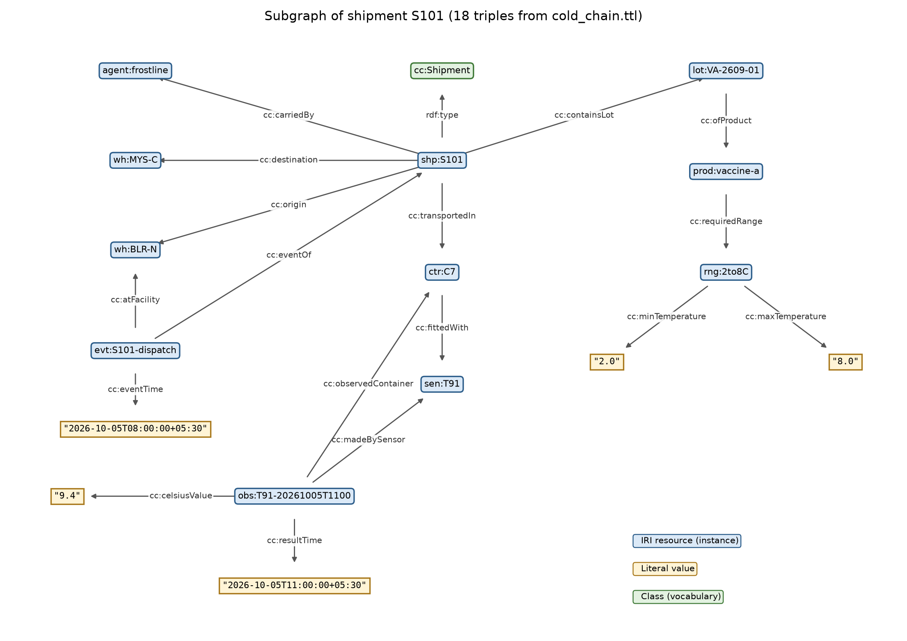

# Cold-Chain Shipment Records – RDF Knowledge Graph

[](https://github.com/Suhas29wasnotavailable/cold-chain-rdf-knowledge-graph/actions/workflows/validate.yml)

**CSE4007 Semantic Web – Option 2: From Case Description to Turtle – Case 2A: Cold-Chain Shipment Records**

An RDF graph with a small RDFS vocabulary for vaccine shipments (S101, S102), refrigerated containers (C7, C8), temperature sensors (T91, T92), timed readings, products (Vaccine-A, Vaccine-B) with permitted temperature ranges, warehouses (Bengaluru-North, Mysuru-Central), a carrier, and dispatch/arrival events. All data is fictional.



## Files

| File | Description |
|---|---|
| `cold_chain.ttl` | RDFS vocabulary (18 classes, 28 properties) and instance data in Turtle. 334 triples |
| `queries.rq` | 8 SPARQL queries: triple count, CQ1–CQ6 and a data-quality validation query, each with its expected result |
| `validate.py` | Parses the file, checks the vocabulary and domain/range, computes the RDFS closure, runs every query and checks each row count |
| `shapes.ttl` | SHACL shapes: cardinalities, datatypes, value bounds and min < max, which RDFS cannot express |
| `shacl_check.py` | Validates the data against `shapes.ttl` with pySHACL (RDFS inference on) |
| `results.txt` | Output of `validate.py` |
| `tests/` | pytest checks of the actual competency-question answers, and that Q8 catches a deliberately broken range |
| `draw_graph.py` | Draws the S101 subgraph and checks each drawn edge against the data |
| `figures/s101_subgraph.png` / `.svg` | Graph figure used in the report |
| `report/report.html` | 5-page report: problem, CQs, vocabulary, 5 modelling decisions, results and limitations |

## Tools
- Python 3.10+ with rdflib 7, owlrl 7, pySHACL and matplotlib (`requirements.txt`)
- Optional: GraphDB Free, for a triple store, RDFS inference and a visual graph; Protégé, for browsing classes and properties

## Reproduce (command line)

```bash
python3 -m venv .venv
source .venv/bin/activate          # Windows: .venv\Scripts\activate
pip install -r requirements.txt
python validate.py                 # prints checks and all query results, writes results.txt
python draw_graph.py               # regenerates figures/s101_subgraph.png
python shacl_check.py              # SHACL validation report
pip install -r requirements-dev.txt && pytest   # checks the CQ answers
```

`validate.py` exits with code 0 only if the vocabulary and domain/range checks pass and every query returns its expected number of rows.

## Reproduce in GraphDB (optional)
1. Open `http://localhost:7200`, then **Setup → Repositories → Create new repository → GraphDB Repository**. Use ID `cold_chain` and ruleset **RDFS (Optimized)**.
2. **Import → Upload RDF files** → `cold_chain.ttl` → Import into the default graph.
3. In the **SPARQL** tab, paste the PREFIX block from `queries.rq` together with one query. Use the **Include inferred** (`>>`) toggle on Q7 to see the inferred results (0 rows without inference, 14 with it).
   Note: GraphDB's Q1 count with inference enabled will differ from owlrl, because each reasoner adds its own axiomatic triples.
4. **Explore → Visual graph** → search `S101`.

## Open in Protégé (optional)
**File → Open → `cold_chain.ttl`.** The vocabulary is plain RDFS (`rdfs:Class`, `rdf:Property`), so Protégé shows the classes and the hierarchy. Properties may be listed as annotation properties, because RDFS does not separate object and datatype properties.

## Expected results

| Query | Question | Expected |
|---|---|---|
| Q1 | Triple count | 334 explicit |
| Q2 | CQ1 – contents, container, carrier, responsible warehouse | 2 rows |
| Q3 | CQ2 – permitted range per shipment | S101 2.0..8.0, S102 −25.0..−15.0 (DEG_C) |
| Q4 | CQ3 – excursions **during transit** | 1 row: S101 / T91 / 11:00 / 9.4 °C (the 1.6 °C pre-dispatch reading is excluded) |
| Q5 | CQ4 – dispatch and arrival times and places | 2 rows |
| Q6 | CQ5 – sensor, calibration date and reading count | T91: 5 readings, T92: 3 readings |
| Q7 | CQ6 – RDFS inference | 0 rows without inference, 14 with inference |
| Q8 | Data-quality validation | 0 rows |

## Acknowledgements
- W3C RDF 1.1 Turtle, RDF Schema 1.1, SOSA/SSN; QUDT units vocabulary.
- AI assistance: Claude (Anthropic) helped draft the model, queries, scripts and report. See report section 8.
